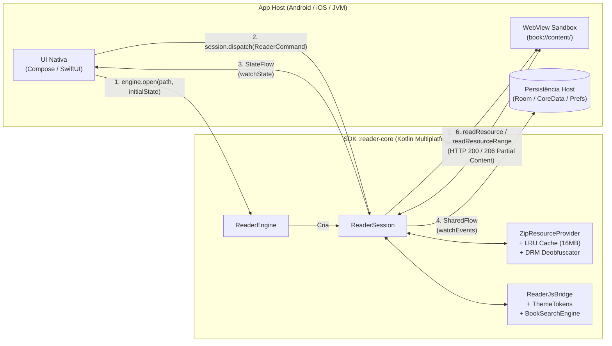

# reader-engine (`:reader-core`)

Motor de leitura digital multiplataforma (**Kotlin Multiplatform — KMP**), *headless* e de alta performance para **Android**, **iOS** e **JVM**.

O SDK **`:reader-core`** (`com.readerengine.core`) concentra toda a engenharia de parsing, segurança, busca, criptografia/DRM, paginação e gerenciamento de estado para livros **EPUB 2**, **EPUB 3** (*reflowable* e *Fixed-Layout*), **HPUB (Baker Framework)** e **JSON**, expondo uma máquina de estados reativa (`ReaderSession`) pronta para ser conectada a qualquer camada de UI nativa (**Jetpack Compose**, **Android Views**, **SwiftUI**, **UIKit** ou **Desktop/Backend JVM**).

---

## Sumário

1. [O que é o SDK e Principais Capacidades](#1-o-que-é-o-sdk-e-principais-capacidades)
2. [Arquitetura e Fluxo de Dados](#2-arquitetura-e-fluxo-de-dados)
3. [Instalação por Canal e Plataforma](#3-instalação-por-canal-e-plataforma)
   - [Android & JVM — GitHub Packages / GitHub Enterprise](#31-android--jvm--github-packages--github-enterprise-ghec--ghes)
   - [Android & JVM — Repositório Público Maven (Sem Credenciais)](#32-android--jvm--repositório-público-maven-sem-credenciais)
   - [iOS — Swift Package Manager / XCFramework](#33-ios--swift-package-manager--xcframework)
4. [Guia de Uso por Plataforma](#4-guia-de-uso-por-plataforma)
   - [Android (Jetpack Compose + WebView + HTTP 206 Streaming)](#41-android-jetpack-compose--webview--http-206-streaming)
   - [iOS (Swift + WKWebView + WKURLSchemeHandler)](#42-ios-swift--wkwebview--wkurlschemehandler)
   - [JVM / Backend / Desktop (Modo Headless)](#43-jvm--backend--desktop-modo-headless)
5. [Customização Avançada (Temas, Paginação, DRM e Limites ZIP)](#5-customização-avançada-temas-paginação-drm-e-limites-zip)
6. [Referência Rápida da API (`ReaderCommand`, `ReaderEvent`, `ReaderUiEffect`)](#6-referência-rápida-da-api)
7. [Estrutura do Repositório e Comandos de Desenvolvimento](#7-estrutura-do-repositório-e-comandos-de-desenvolvimento)

---

## 1. O que é o SDK e Principais Capacidades

Construir um leitor EPUB/HPUB corporativo em múltiplas plataformas costuma exigir duplicação de parsers complexos, tratamento de arquivos gigantes em memória, desofuscação de fontes e sincronização frágil com WebViews. O **`reader-engine`** resolve isso com uma arquitetura híbrida: **100% da inteligência de domínio roda em Kotlin Multiplatform (`:reader-core`)**, enquanto a `WebView` nativa do sistema operacional atua apenas como *sandbox* de renderização HTML5/CSS3/MathML.

| Capacidade | Descrição Técnica |
|------------|-------------------|
| **Formatos Suportados** | **EPUB 2**, **EPUB 3** (*Reflowable* e *Fixed-Layout* `pre-paginated`), **HPUB** (`book.json`) e **JSON** estruturado. |
| **Streaming em Disco (`Okio FileHandle`)** | Abre livros de centenas de megabytes diretamente do disco (`okio.Path`) lendo apenas o *Central Directory* nos 65 KB finais do ZIP, sem carregar o arquivo inteiro na RAM. |
| **Cache LRU Thread-Safe & Anti-Zip Bomb** | Cache LRU em memória limitado a **16 MB** protegido por `Mutex` e proteção determinística contra *Zip Bombs* (`ZipLimits`: máx. 10.000 entradas, 50 MB/entrada, 1 GB total) e *Path Traversal*. |
| **Streaming de Vídeo e Áudio (HTTP 206)** | Leitura parcial zero-copy (`readResourceRange`) para entradas `STORED`, permitindo *seek* instantâneo e *buffering* em tags `<video>` e `<audio>` embarcadas no EPUB 3. |
| **DRM Plugável e Desofuscação de Fontes** | Processa `META-INF/encryption.xml`, desofusca fontes **IDPF** (SHA-1 1040B) e **Adobe** (UUID 1024B) nativamente e aceita `ContentDecryptor` customizado (ex.: Readium LCP). |
| **Rolagem Contínua e Paginação CSS** | Alternância em tempo real entre `ReadingMode.SCROLL` e `ReadingMode.PAGINATED` (colunas horizontais CSS3 com sincronização de sub-páginas), além de suporte a **MathML**. |
| **Busca Full-Text sem Acentos** | `BookSearchEngine` realiza busca *case-insensitive* e insensível a diacríticos (`foldDiacritics` 1-para-1) em todo o *spine*, retornando *snippets* de contexto e `Locator`. |
| **Destaques, Favoritos e Formulários** | Persistência automática de *Highlights* (4 cores + sublinhado), *Bookmarks*, anotações e campos `<input>`/`<textarea>`/`<select>` com compressão automática `gz:<base64>` (`PayloadCodec`). |
| **API Explícita e Ergonomia iOS** | Compilado com `explicitApi()` e equipado com `FlowSubscription` (`watchState`, `watchEvents`, `watchUiEffects`) para consumo direto em Swift sem gerenciar Coroutines. |

---

## 2. Arquitetura e Fluxo de Dados

O SDK segue o padrão **Unidirectional Data Flow (UDF)**:



---

## 3. Instalação por Canal e Plataforma

### 3.1 Android & JVM — GitHub Packages / GitHub Enterprise (GHEC & GHES)

Ideal para ambientes corporativos (**GitHub Enterprise Cloud** ou **GitHub Enterprise Server**).

No seu `settings.gradle.kts` (ou `build.gradle.kts`):

```kotlin
dependencyResolutionManagement {
    repositories {
        google()
        mavenCentral()
        maven {
            // GitHub Enterprise Cloud: https://maven.pkg.github.com/<org>/reader-engine
            // GitHub Enterprise Server (Subdomain Isolation): https://maven.<seu-host-ghe>/<org>/reader-engine
            url = uri(
                providers.gradleProperty("githubPackagesUrl")
                    .orElse("https://maven.pkg.github.com/Casa-Publicadora-Brasileira/reader-engine")
                    .get()
            )
            credentials {
                username = providers.gradleProperty("gpr.user")
                    .orElse(providers.environmentVariable("GITHUB_ACTOR"))
                    .orNull
                password = providers.gradleProperty("gpr.key")
                    .orElse(providers.environmentVariable("GITHUB_TOKEN"))
                    .orNull
            }
        }
    }
}
```

No `build.gradle.kts` do módulo consumidor:

```kotlin
dependencies {
    // Em um projeto Kotlin Multiplatform (commonMain):
    implementation("com.readerengine:reader-core:0.3.2")

    // Ou diretamente em um projeto Android puro:
    implementation("com.readerengine:reader-core-android:0.3.2")

    // Ou em um projeto JVM puro (Desktop / Backend):
    implementation("com.readerengine:reader-core-jvm:0.3.2")
}
```

---

### 3.2 Android & JVM — Repositório Público Maven (Sem Credenciais)

Para testes rápidos ou projetos sem necessidade de token:

```kotlin
repositories {
    google()
    mavenCentral()
    maven {
        url = uri("https://raw.githubusercontent.com/Casa-Publicadora-Brasileira/reader-engine/mvn-repo")
    }
}

dependencies {
    implementation("com.readerengine:reader-core-android:0.3.2")
}
```

---

### 3.3 iOS — Swift Package Manager / XCFramework

O pipeline de release gera o binário universal **`ReaderCore.xcframework.zip`** contendo as fatias `iosArm64` (dispositivos físicos), `iosSimulatorArm64` (simuladores Apple Silicon) e `iosX64` (simuladores Intel).

#### Opção A: Via `Package.swift` (Swift Package Manager)
```swift
dependencies: [
    .package(url: "https://github.com/Casa-Publicadora-Brasileira/reader-engine.git", from: "0.3.2")
]
```

#### Opção B: Gerar o `XCFramework` localmente (macOS)
```bash
./gradlew :reader-core:assembleReaderCoreReleaseXCFramework
```
O artefato será gerado em `reader-core/build/XCFrameworks/release/ReaderCore.xcframework` e pode ser arrastado diretamente para **Xcode → Target → Frameworks, Libraries, and Embedded Content**.

---

## 4. Guia de Uso por Plataforma

### 4.1 Android (Jetpack Compose + WebView + HTTP 206 Streaming)

No Android, o ciclo de integração consiste em 4 passos simples (veja a implementação completa de referência em [`sample-android/src/main/java/com/readerengine/app/MainActivity.kt`](sample-android/src/main/java/com/readerengine/app/MainActivity.kt)):

#### Passo 1: Abrir o livro a partir do disco (`Okio Path`) com `InitialBookState`
```kotlin
import com.readerengine.core.model.InitialBookState
import com.readerengine.core.model.ReadingMode
import com.readerengine.core.session.ReaderEngine
import com.readerengine.core.theme.ThemeTokens
import okio.Path.Companion.toOkioPath
import java.io.File

val engine = ReaderEngine()
val epubFile = File(context.filesDir, "meu-livro.epub")

val session = engine.open(
    path = epubFile.toOkioPath(),
    initialState = InitialBookState(
        documentId = "livro-001",
        initialPageIndex = savedPageIndex,
        initialScrollY = savedScrollY,
        readingMode = ReadingMode.SCROLL,
        theme = ThemeTokens.material3(),
    ),
)
```

#### Passo 2: Interceptar `book://content/` na `WebViewClient` (com suporte a HTTP 206 para Vídeo/Áudio)
```kotlin
class BookWebViewClient(
    private val session: ReaderSession,
) : WebViewClient() {

    override fun shouldInterceptRequest(
        view: WebView?,
        request: WebResourceRequest?,
    ): WebResourceResponse? {
        val url = request?.url?.toString() ?: return null
        val prefix = ReaderSession.DEFAULT_BOOK_BASE_URL // "book://content/"
        if (!url.startsWith(prefix)) return super.shouldInterceptRequest(view, request)

        val relPath = url.removePrefix(prefix).substringBefore('#').substringBefore('?')
        val mimeType = session.resourceMediaType(relPath) ?: "application/octet-stream"
        val rangeHeader = request.requestHeaders["Range"] ?: request.requestHeaders["range"]

        // Suporte a Streaming Parcial HTTP 206 (ex.: <video> e <audio> embarcados no EPUB)
        if (!rangeHeader.isNullOrBlank() && rangeHeader.startsWith("bytes=")) {
            val totalSize = session.resourceSize(relPath) ?: return null
            val parts = rangeHeader.removePrefix("bytes=").split('-', limit = 2)
            val start = parts[0].toLongOrNull() ?: 0L
            val maxChunk = 1024 * 1024 // 1 MB por fatia
            val end = parts.getOrNull(1)?.takeIf { it.isNotBlank() }?.toLongOrNull()
                ?.coerceAtMost(totalSize - 1)
                ?: (start + maxChunk - 1).coerceAtMost(totalSize - 1)
            val length = (end - start + 1).toInt().coerceAtMost(maxChunk)
            val actualEnd = start + length - 1

            val slice = session.readResourceRange(relPath, start, length)
            return WebResourceResponse(
                mimeType,
                null,
                206,
                "Partial Content",
                mapOf(
                    "Accept-Ranges" to "bytes",
                    "Content-Range" to "bytes $start-$actualEnd/$totalSize",
                    "Content-Length" to slice.size.toString(),
                    "Access-Control-Allow-Origin" to "*",
                ),
                slice.inputStream(),
            )
        }

        // Recursos padrão (XHTML, CSS, Fontes desofuscadas, Imagens) -> HTTP 200
        val bytes = runCatching { session.readResource(relPath) }.getOrNull()
            ?: return WebResourceResponse("text/plain", "UTF-8", 404, "Not Found", emptyMap(), "".byteInputStream())

        return WebResourceResponse(mimeType, null, bytes.inputStream())
    }

    override fun shouldOverrideUrlLoading(view: WebView?, request: WebResourceRequest?): Boolean {
        val url = request?.url?.toString() ?: return false
        return session.handleUrlNavigation(url)
    }
}
```

#### Passo 3: Observar Estado, Eventos de Persistência e Efeitos de UI no Jetpack Compose
```kotlin
@Composable
fun ReaderView(session: ReaderSession) {
    val state by session.state.collectAsState()
    var webViewRef by remember { mutableStateOf<WebView?>(null) }

    // 1. Persistir progresso, destaques, bookmarks e formulários automaticamente
    LaunchedEffect(session) {
        session.events.collect { event ->
            when (event) {
                is ReaderEvent.ProgressUpdated ->
                     repository.saveProgress(event.progress)
                is ReaderEvent.PageHighlightsChanged ->
                    repository.saveHighlights(event.documentId, event.pageIndex, event.compressedPayload)
                is ReaderEvent.PageFormChanged ->
                    repository.saveForms(event.documentId, event.pageIndex, event.compressedPayload)
                is ReaderEvent.BookmarksChanged ->
                    repository.saveBookmarks(event.documentId, event.serializedJson)
                is ReaderEvent.PreferencesChanged ->
                    repository.savePreferences(event)
                is ReaderEvent.ActionTriggered ->
                    println("Ação interativa do livro: ${event.action} -> ${event.payload}")
            }
        }
    }

    // 2. Executar efeitos pontuais na WebView (Scroll, JS de paginação/highlights, Links externos)
    LaunchedEffect(session) {
        session.uiEffects.collect { effect ->
            when (effect) {
                is ReaderUiEffect.EvaluateJs -> webViewRef?.evaluateJavascript(effect.script, null)
                is ReaderUiEffect.ScrollToY -> webViewRef?.scrollTo(0, effect.scrollYPx)
                is ReaderUiEffect.OpenExternalUrl -> openBrowser(effect.url)
                is ReaderUiEffect.OpenCustomUri -> showPopup(effect.title, effect.content)
                is ReaderUiEffect.CustomAction -> handleCustomAction(effect.action, effect.payload)
                is ReaderUiEffect.ShowMessage -> showToast(effect.message)
            }
        }
    }

    // 3. Renderizar o documento HTML injetado sempre que o capítulo, tema ou modo mudar
    val renderedDoc = remember(
        state.pageIndex,
        state.theme,
        state.fontScale,
        state.isNightMode,
        state.readingMode,
    ) {
        session.currentDocument()
    }

    AndroidView(
        factory = { ctx ->
            WebView(ctx).apply {
                settings.javaScriptEnabled = true
                settings.allowFileAccess = false
                settings.allowContentAccess = false
                webViewClient = BookWebViewClient(session)
                webViewRef = this
            }
        },
        update = { webView ->
            webView.loadDataWithBaseURL(
                renderedDoc.baseUrl,
                renderedDoc.html,
                "text/html",
                "UTF-8",
                null,
            )
        },
    )
}
```

---

### 4.2 iOS (Swift + `WKWebView` + `WKURLSchemeHandler`)

No iOS (`ReaderCore.xcframework`), o SDK expõe observadores baseados em *closures* (`watchState`, `watchEvents`, `watchUiEffects`) que retornam `FlowSubscription` e sobrecargas concisas sem necessidade de lidar com `CoroutineScope` do Kotlin:

#### Passo 1: Implementar o `WKURLSchemeHandler` para `book://content/`
```swift
import WebKit
import ReaderCore

final class BookSchemeHandler: NSObject, WKURLSchemeHandler {
    private let session: ReaderSession

    init(session: ReaderSession) {
        self.session = session
    }

    func webView(_ webView: WKWebView, start urlSchemeTask: WKURLSchemeTask) {
        guard let url = urlSchemeTask.request.url else { return }
        let prefix = ReaderSession.Companion.shared.DEFAULT_BOOK_BASE_URL // "book://content/"
        let relPath = url.absoluteString
            .replacingOccurrences(of: prefix, with: "")
            .components(separatedBy: "#").first ?? ""

        let mimeType = session.resourceMediaType(href: relPath) ?? "application/octet-stream"
        let kotlinBytes = session.readResource(href: relPath)
        let data = kotlinBytes.toNSData() // Conversão KotlinByteArray -> Data

        let response = URLResponse(
            url: url,
            mimeType: mimeType,
            expectedContentLength: data.count,
            textEncodingName: "utf-8"
        )
        urlSchemeTask.didReceive(response)
        urlSchemeTask.didReceive(data)
        urlSchemeTask.didFinish()
    }

    func webView(_ webView: WKWebView, stop urlSchemeTask: WKURLSchemeTask) {}
}
```

#### Passo 2: Inicializar a `ReaderSession` e observar com `FlowSubscription`
```swift
import UIKit
import WebKit
import ReaderCore

final class ReaderViewController: UIViewController {
    private let engine = ReaderEngine()
    private var session: ReaderSession?
    private var stateSub: FlowSubscription?
    private var eventsSub: FlowSubscription?
    private var effectsSub: FlowSubscription?
    private var webView: WKWebView!

    func openBook(at fileURL: URL) {
        let epubData = try! Data(contentsOf: fileURL)
        let kotlinBytes = epubData.toKotlinByteArray()

        let readerSession = engine.open(name: fileURL.lastPathComponent, bytes: kotlinBytes)
        self.session = readerSession

        // 1. Observar Estado Reativo
        stateSub = readerSession.watchState { [weak self] state in
            guard let self = self else { return }
            self.title = "\(state.metadata.title) (\(state.pageIndex + 1)/\(state.spineLen))"
            let doc = readerSession.currentDocument()
            self.webView.loadHTMLString(doc.html, baseURL: URL(string: doc.baseUrl))
        }

        // 2. Observar Eventos para Persistência (CoreData / UserDefaults)
        eventsSub = readerSession.watchEvents { event in
            if let progressEvent = event as? ReaderEventProgressUpdated {
                print("Progresso salvo: \(progressEvent.progress.totalPercentage)%")
            }
        }

        // 3. Observar Efeitos de UI (JS / Scroll)
        effectsSub = readerSession.watchUiEffects { [weak self] effect in
            if let jsEffect = effect as? ReaderUiEffectEvaluateJs {
                self?.webView.evaluateJavaScript(jsEffect.script, completionHandler: nil)
            }
        }
    }

    func goToNextPage() {
        session?.dispatch(command: ReaderCommandNextPage.shared)
    }

    deinit {
        stateSub?.cancel()
        eventsSub?.cancel()
        effectsSub?.cancel()
        session?.close()
    }
}
```

---

### 4.3 JVM / Backend / Desktop (Modo Headless)

Na JVM (servidores de indexação, validação de acervo, pré-processamento ou aplicativos Compose Multiplatform Desktop), o `:reader-core` funciona de forma 100% *headless* sem exigir WebView:

```kotlin
import com.readerengine.core.session.ReaderEngine
import okio.Path.Companion.toPath

fun main() {
    val engine = ReaderEngine()

    // Abre o EPUB direto do disco via Okio FileHandle
    val session = engine.open(path = "/acervo/dom-casmurro.epub".toPath())

    try {
        val state = session.state.value
        println("Título: ${state.metadata.title}")
        println("Autor: ${state.metadata.author}")
        println("Layout EPUB 3: ${state.metadata.layout}") // REFLOWABLE ou PRE_PAGINATED
        println("Total de capítulos na spine: ${state.spineLen}")

        // Sumário hierárquico achatado (TOC)
        state.toc.forEach { item ->
            val indent = "  ".repeat(item.level)
            println("$indent- ${item.title} (página ${item.spineIndex + 1})")
        }

        // Busca full-text insensível a acentos e caixa em todo o livro
        val results = session.search(query = "capitu", maxResults = 20)
        results.forEach { hit ->
            println("[Cap. ${hit.pageIndex + 1}] ${hit.snippet} (locator: ${hit.locator.href})")
        }

        // Gerar o HTML injetado do capítulo atual
        val rendered = session.currentDocument()
        println("Base URL: ${rendered.baseUrl} | Tamanho HTML: ${rendered.html.length} chars")
    } finally {
        session.close()
    }
}
```

---

## 5. Customização Avançada (Temas, Paginação, DRM e Limites ZIP)

### 5.1 Design Systems e Temas (`ThemeTokens`)
O SDK inclui presets prontos para **Material 3** (Android), **Human Interface Guidelines — HIG** (iOS), **Fluent** (Windows/Web) e temas totalmente customizados (com sanitização anti-CSS Injection automática):

```kotlin
// Presets integrados
session.dispatch(ReaderCommand.SetTheme(ThemeTokens.material3()))
session.dispatch(ReaderCommand.SetTheme(ThemeTokens.hig()))
session.dispatch(ReaderCommand.SetTheme(ThemeTokens.fluent()))

// Tema customizado (ex.: Sépia Editorial)
session.dispatch(
    ReaderCommand.SetTheme(
        ThemeTokens.custom(
            background = "#F5ECD7",
            foreground = "#2C221E",
            accent = "#8D4E2A",
            surface = "#EFE3C6",
            link = "#7A3E1D",
        )
    )
)

// Modo Noturno e Escala de Fonte (0.5f a 3.0f)
session.dispatch(ReaderCommand.SetNightMode(enabled = true))
session.dispatch(ReaderCommand.SetFontScale(scale = 1.25f))
```

### 5.2 Alternância entre Rolagem (`SCROLL`) e Paginação por Colunas (`PAGINATED`)
```kotlin
// Muda para paginação horizontal estilo e-reader (CSS Multi-Column)
session.dispatch(ReaderCommand.SetReadingMode(ReadingMode.PAGINATED))

// Em modo PAGINATED, NextPage e PrevPage avançam/retrocedem entre as sub-páginas (colunas)
// do capítulo atual e transitam automaticamente para o próximo capítulo ao final!
session.dispatch(ReaderCommand.NextPage)
```

### 5.3 DRM Customizado (`ContentDecryptor`) + Desofuscação Automática IDPF/Adobe
Fontes ofuscadas pelos padrões oficiais **IDPF** (`http://www.idpf.org/2008/embedding`) e **Adobe** (`http://ns.adobe.com/pdf/enc#RC`) declaradas em `META-INF/encryption.xml` são desofuscadas automaticamente pelo SDK. Para livros protegidos por DRM comercial (ex.: Readium LCP ou AES proprietário), basta injetar um `ContentDecryptor`:

```kotlin
val engine = ReaderEngine(
    customDecryptor = ContentDecryptor { href, rawBytes, encryptionInfo, fallback ->
        if (encryptionInfo.encryptionMethodUri == "http://readium.org/2014/01/lcp#aes256-cbc") {
            myLcpService.decrypt(href, rawBytes, encryptionInfo)
        } else {
            // Delega de volta para o desofuscador padrão IDPF/Adobe
            fallback?.decrypt(href, rawBytes, encryptionInfo, null) ?: rawBytes
        }
    }
)
```

### 5.4 Limites de Segurança ZIP (`ZipLimits`)
Você pode ajustar os limites de proteção contra *Zip Bomb* e o tamanho do cache LRU em memória ao instanciar o `ReaderEngine`:

```kotlin
val engine = ReaderEngine(
    zipLimits = ZipLimits(
        maxEntries = 10_000,
        maxEntryUncompressedBytes = 50L * 1024L * 1024L,   // 50 MB por entrada em memória
        maxTotalUncompressedBytes = 1024L * 1024L * 1024L, // 1 GB declarado no ZIP
        maxMemoryCacheBytes = 16L * 1024L * 1024L,         // 16 MB de cache LRU thread-safe
    )
)
```

---

## 6. Referência Rápida da API

### Comandos (`session.dispatch(ReaderCommand)`)

| Comando | Descrição |
|---------|-----------|
| `ReaderCommand.NextPage` | Avança para a próxima sub-página (se `PAGINATED`) ou próximo capítulo do *spine*. |
| `ReaderCommand.PrevPage` | Retrocede para a sub-página anterior (se `PAGINATED`) ou capítulo anterior. |
| `ReaderCommand.GoToPage(pageIndex, scrollY)` | Salta diretamente para o índice do capítulo (`0 until spineLen`) e posição `scrollY`. |
| `ReaderCommand.GoToHref(href)` | Navega para um caminho interno do livro (ex.: `"OEBPS/ch02.xhtml#sec1"`). |
| `ReaderCommand.GoToLocator(locator)` | Navega utilizando um objeto `Locator` (ex.: vindo de um `SearchResult`). |
| `ReaderCommand.UpdateScroll(scrollY, contentHeightPx, viewportHeightPx)` | Atualiza a posição de rolagem e recalcula o `ReadingProgress` monotônico (com *throttling* de 2px). |
| `ReaderCommand.SetReadingMode(mode)` | Alterna entre `ReadingMode.SCROLL` e `ReadingMode.PAGINATED`. |
| `ReaderCommand.SetTheme(theme)` | Aplica um `ThemeTokens` (`material3()`, `hig()`, `fluent()`, `custom(...)`). |
| `ReaderCommand.SetNightMode(enabled)` | Ativa ou desativa o modo noturno. |
| `ReaderCommand.SetFontScale(scale)` | Define o multiplicador tipográfico (`0.5f..3.0f`). |
| `ReaderCommand.SetFontFamily(fontFamily)` | Altera a família tipográfica (sanitizada contra CSS Injection). |
| `ReaderCommand.ApplyHighlightStyle(style)` | Aplica destaque (`YELLOW`, `GREEN`, `BLUE`, `PINK`, `UNDERLINE`) na seleção ativa da WebView. |
| `ReaderCommand.RemoveSelectedHighlight` | Remove o destaque atualmente selecionado na WebView. |
| `ReaderCommand.RemoveHighlightItem(highlightId)` | Remove um destaque específico pelo seu ID na página atual. |
| `ReaderCommand.ToggleBookmark(label)` | Adiciona ou remove um marcador (`Bookmark`) na página atual. |
| `ReaderCommand.GoToBookmark(bookmarkId)` | Navega para a página e `scrollY` salvos no marcador. |
| `ReaderCommand.RemoveBookmark(bookmarkId)` | Exclui um marcador específico pelo ID. |
| `ReaderCommand.TriggerAction(action, payload)` | Dispara uma ação customizada emitindo `ActionTriggered` e `CustomAction`. |

---

## 7. Estrutura do Repositório e Comandos de Desenvolvimento

```text
reader-engine/
├── reader-core/                       # SDK KMP (:reader-core -> Android AAR / iOS XCFramework / JVM JAR)
│   └── src/
│       ├── commonMain/kotlin/com/readerengine/core/
│       │   ├── bridge/                # ReaderJsBridge (Scroll, CSS Columns, MathML) & PayloadCodec (gz:)
│       │   ├── drm/                   # ContentDecryptor, EpubEncryptionParser, StandardEpubFontDeobfuscator
│       │   ├── error/                 # ReaderException (UnsupportedFormat, InvalidContent, ResourceNotFound)
│       │   ├── model/                 # Publication, Locator, ReadingMode, ReadingProgress, HighlightItem...
│       │   ├── parser/                # EpubParser, HpubParser, JsonParser, XmlEntities, ParserRegistry
│       │   ├── provider/              # ZipResourceProvider (Okio FileHandle, LRU Cache 16MB, ZipLimits)
│       │   ├── search/                # BookSearchEngine (busca full-text sem acentos com cache)
│       │   ├── session/               # ReaderEngine, ReaderSession, FlowSubscription, RenderedDocument
│       │   └── theme/                 # ThemeTokens (Material 3, HIG, Fluent, Custom)
│       └── commonTest/                # 76 testes unitários e de regressão multiplataforma
├── sample-android/                    # App Android de referência (:sample-android) em Jetpack Compose
├── fixtures/                          # Arquivos de teste (.epub, .hpub, .json)
└── _reversa_sdd/                      # Especificação arquitetural completa (C4, ERD, ADRs, Contratos SDD)
```

### Comandos Úteis

```bash
# Executar a suíte completa de testes unitários KMP (JVM)
./gradlew :reader-core:jvmTest

# Gerar o AAR de Release do Android e o JAR da JVM
./gradlew :reader-core:assembleRelease :reader-core:jvmJar

# Compilar o aplicativo Android de demonstração (:sample-android)
./gradlew :sample-android:assembleDebug

# Gerar o XCFramework universal para iOS (requer macOS + Xcode)
./gradlew :reader-core:assembleReaderCoreReleaseXCFramework

# Publicar artefatos no GitHub Packages / GitHub Enterprise
./gradlew :reader-core:publishAndroidReleasePublicationToGitHubPackagesRepository \
          :reader-core:publishJvmPublicationToGitHubPackagesRepository \
          :reader-core:publishKotlinMultiplatformPublicationToGitHubPackagesRepository
```

---

## Licença

Distribuído sob a licença MIT. Veja [LICENSE](LICENSE) para mais detalhes.
