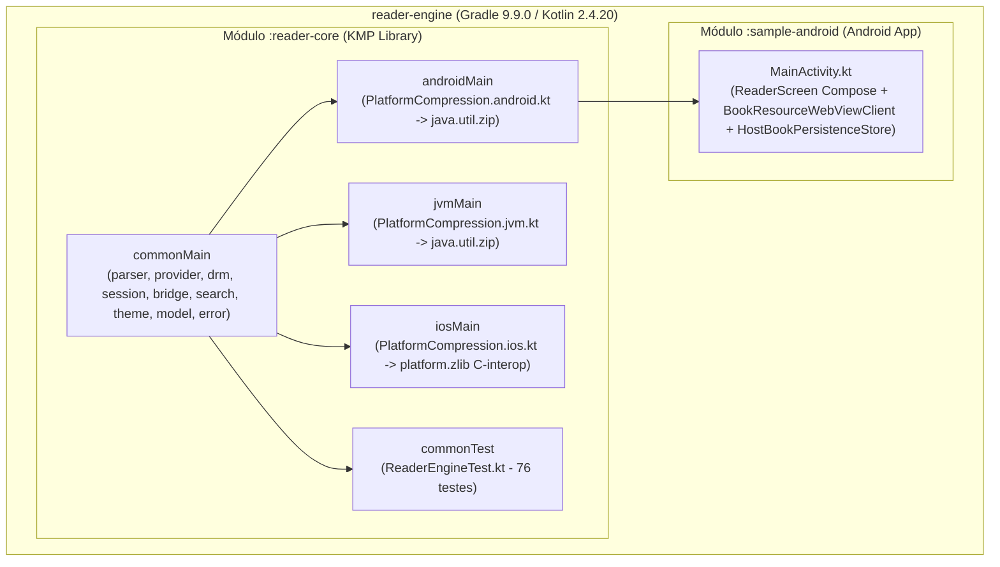

# Arquitetura do Sistema — `reader-engine`

> Gerado pelo **Architect** (Reversa v1.3.6) | Nível: `detalhado`

---

## 1. Visão Geral Arquitetural

O **`reader-engine`** é um motor de leitura digital multiplataforma (Kotlin Multiplatform — KMP) projetado para abrir, interpretar, desofuscar, pesquisar e gerenciar o estado de leitura de publicações **EPUB 2**, **EPUB 3** (reflowable e fixed-layout com mídia rica e MathML), **HPUB** e **`reader-json`**.

A arquitetura adota o padrão **Unidirectional Data Flow (UDF) / MVI Híbrido**:
- **Domínio e Estado 100% em KMP (`reader-core`):** Toda a lógica de I/O de arquivos ZIP em disco via `Okio FileHandle`, parsing estrutural XML/JSON, desofuscação criptográfica de fontes (IDPF/Adobe), busca textual index-preserving, máquina de estado de sessão (`ReaderSession`) e geração de HTML/CSS/JS (`ReaderJsBridge`, `ThemeTokens`) reside em `commonMain`.
- **Camada Host Fina (`sample-android` / consumidores iOS/JVM):** O aplicativo host fornece a `WebView` nativa (`android.webkit.WebView` ou `WKWebView`), intercepta o esquema virtual `book://content/` para servir bytes do `ReaderSession` (incluindo HTTP `206 Partial Content` para streaming de vídeo/áudio) e persiste o estado serializado (`HostBookPersistenceStore` + `PayloadCodec`).

---

## 2. Princípios Arquiteturais Confirmados no Código

| Princípio | Evidência Técnica | Confiança |
|-----------|-------------------|-----------|
| **Zero Heavy Dependencies no Core** | Apenas 3 dependências externas em `commonMain`: `kotlinx-coroutines-core`, `kotlinx-serialization-json` e `okio`. Nenhum parser XML pesado ou motor Web embarcado no core. | 🟢 CONFIRMADO |
| **Explicit API Mode (`explicitApi()`)** | Todas as classes, funções e propriedades públicas de `reader-core` possuem modificadores de visibilidade e tipos explícitos (`reader-core/build.gradle.kts:42`). | 🟢 CONFIRMADO |
| **Streaming & Lazy I/O em Disco** | Arquivos grandes são lidos sob demanda via `okio.FileHandle` com indexação apenas do Central Directory ZIP nos 65.557 bytes finais e cache LRU limitado a 16 MB. | 🟢 CONFIRMADO |
| **Comunicação Reativa e Desacoplada** | `ReaderSession` recebe `ReaderCommand` via `dispatch(...)` e emite estado em `StateFlow<ReaderState>`, eventos de domínio em `SharedFlow<ReaderEvent>` e efeitos de WebView em `SharedFlow<ReaderUiEffect>`. | 🟢 CONFIRMADO |
| **Interoperabilidade Nativa iOS First-Class** | `FlowSubscription` encapsula a coleta de `Flow` em callbacks canceláveis (`watchState`, `watchEvents`, `watchUiEffects`) e `PlatformCompression.ios.kt` usa `platform.zlib` via C-interop nativo. | 🟢 CONFIRMADO |

---

## 3. Topologia de Módulos e Targets KMP

---

## 4. Integrações e Protocolos Internos/Externos

### 4.1 Protocolo Virtual `book://content/<href>`
- **Direção:** `WebView` -> `BookResourceWebViewClient.shouldInterceptRequest` -> `ReaderSession` -> `DecryptingResourceProvider` -> `ZipResourceProvider`.
- **Semântica:**
  - Requisições padrão sem cabeçalho `Range`: retornam `200 OK` com `session.readResourceBytes(href)`.
  - Requisições de mídia (`<video>`, `<audio>`) com cabeçalho `Range: bytes=start-end`: retornam `206 Partial Content` com fatias de até **1 MB** via `session.readResourceRange(href, start, length)` e cabeçalhos `Accept-Ranges: bytes` e `Content-Range: bytes start-end/total`.

### 4.2 Ponte JavaScript Bidirecional (`ReaderJsBridge`)
- **Nativo -> WebView (`evaluateJavascript`):**
  - `window.readerJS.applyTheme(cssVarsJson)`
  - `window.readerJS.setFontSize(sp)`
  - `window.readerJS.applyHighlights(highlightsJson)`
  - `window.readerJS.restoreForms(formsJson)`
  - `window.readerJS.clearForms()`
  - `window.readerJS.nextSubPage()` / `prevSubPage()` / `goToSubPage(idx)`
- **WebView -> Nativo (`@JavascriptInterface`):**
  - `AndroidScroll.onScrollProgress(scrollY, contentHeight, viewportHeight)` -> despacha `ReaderCommand.UpdateScroll`.
  - `ReaderNativeBridge.postMessage(payloadJson)` -> processa eventos JSON (`type: "highlight" | "form" | "subpage" | "navigate"`) e despacha os respectivos `ReaderCommand`.

---

## 5. Registro de Dívidas Técnicas e Pontos de Atenção

| ID | Categoria | Descrição Técnica | Localização | Severidade | Confiança |
|----|-----------|-------------------|-------------|------------|-----------|
| **DT-01** | Modularização UI Host | `MainActivity.kt` no `sample-android` concentra `ScrollProgressInterface`, `ActionBridge`, `HostBookPersistenceStore`, `BookResourceWebViewClient`, `MainActivity` e `ReaderScreen` (1.127 linhas) em um único arquivo. | `sample-android/src/main/java/com/readerengine/app/MainActivity.kt` | Baixa (apenas no app sample) | 🟢 CONFIRMADO |
| **DT-02** | Parsing XML/HTML via Regex | `EpubParser` e `EpubEncryptionParser` utilizam expressões regulares otimizadas em vez de um parser DOM/SAX/StAX multiplataforma para evitar dependências externas. Embora coberto por 76 testes, XMLs com comentários aninhados atípicos ou CDATA complexos no `.opf` podem exigir cuidado. | `EpubParser.kt`, `DrmProvider.kt` | Baixa / Média | 🟢 CONFIRMADO |
| **DT-03** | Duplicação Idêntica entre `PlatformCompression.jvm.kt` e `PlatformCompression.android.kt` | As implementações `actual` de `inflateRaw`, `gzipCompress` e `gzipDecompress` para Android e JVM são 100% idênticas (61 linhas cada usando `java.util.zip`), podendo compartilhar um sourceSet intermediário `jvmAndAndroidMain`. | `reader-core/src/jvmMain/...`, `reader-core/src/androidMain/...` | Baixa | 🟢 CONFIRMADO |
| **DT-04** | Ausência de Suporte a ZIP64 | `ZipResourceProvider` rejeita explicitamente arquivos ZIP64 (`totalEntries == 0xFFFF` ou `centralDirSize == 0xFFFFFFFFL`), limitando containers EPUB individuais a 4 GB e 65.535 entradas. | `ZipResourceProvider.kt:200` | Baixa (limite de `ZipLimits` já é 1 GB e 10.000 entradas) | 🟢 CONFIRMADO |
