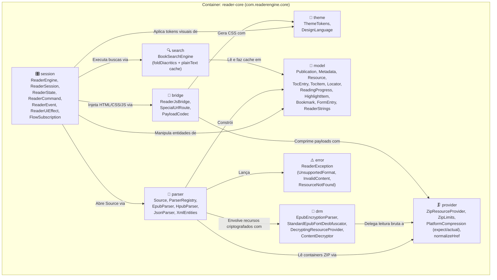
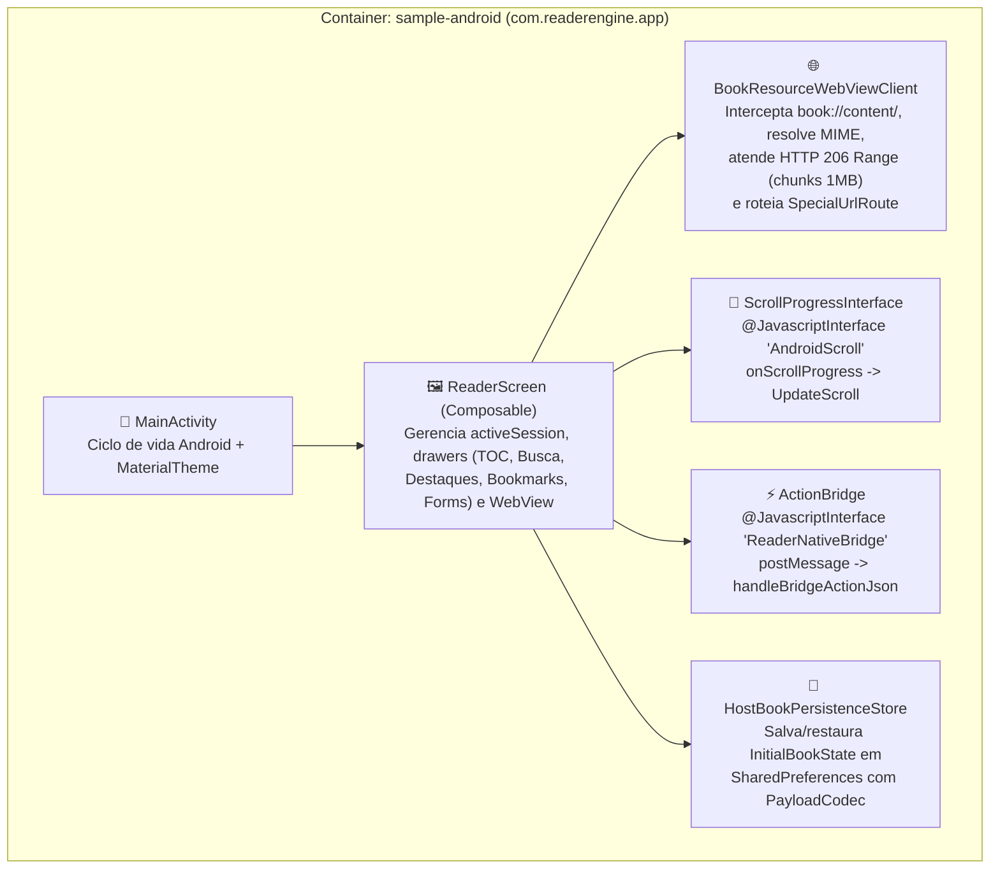

# Diagrama C4 — Nível 3: Componentes (`c4-components`)

> Gerado pelo **Architect** (Reversa v1.3.6) | Nível: `detalhado`

---

## 1. Componentes Internos do Container `reader-core`

O diagrama abaixo detalha os 9 subpacotes internos de `com.readerengine.core` e suas dependências diretas:

---

## 2. Componentes Internos do Container `sample-android`

---

## 3. Responsabilidades por Componente

| Container | Componente | Arquivos Principais | Responsabilidade Crítica | Confiança |
|-----------|------------|---------------------|--------------------------|-----------|
| `reader-core` | `session` | `ReaderSession.kt`, `FlowSubscription.kt` | Orquestração de estado imutável (`ReaderState`), despacho de 18 comandos, resolução de `href` em 3 etapas e wrappers reativos para iOS. | 🟢 CONFIRMADO |
| `reader-core` | `parser` | `Source.kt`, `EpubParser.kt`, `HpubParser.kt`, `JsonParser.kt`, `XmlEntities.kt` | Detecção de formato, extração de metadados OPF/Dublin Core, construção de TOC aninhado (`<nav>` e `.ncx`), spine linear e decodificação de entidades XML. | 🟢 CONFIRMADO |
| `reader-core` | `provider` | `ZipResourceProvider.kt`, `PlatformCompression.*.kt` | Leitura do Central Directory ZIP, validação de `ZipLimits`, cache LRU thread-safe de 16 MB, `readRange` zero-copy e `inflateRaw`/GZIP nativo. | 🟢 CONFIRMADO |
| `reader-core` | `drm` | `DrmProvider.kt` | Parsing de `META-INF/encryption.xml`, desofuscação IDPF (SHA-1 1040B) e Adobe (UUID 1024B), e delegação para `ContentDecryptor`. | 🟢 CONFIRMADO |
| `reader-core` | `bridge` | `ReaderJsBridge.kt`, `PayloadCodec.kt` | Transformação HTML/CSS/JS para WebView, paginação por colunas CSS, polyfill `window.readerJS`, roteamento de URLs e compressão `gz:<base64>`. | 🟢 CONFIRMADO |
| `reader-core` | `search` | `BookSearchEngine.kt` | Extração de texto plano com cache em `Publication`, normalização `foldDiacritics` 1-para-1 e geração de snippets de contexto. | 🟢 CONFIRMADO |
| `reader-core` | `theme` | `ThemeTokens.kt` | Presets visuais (`MATERIAL3`, `HIG`, `FLUENT`, `CUSTOM`), variáveis CSS de modo noturno/MathML e sanitização anti-CSS Injection. | 🟢 CONFIRMADO |
| `sample-android` | `BookResourceWebViewClient` | `MainActivity.kt:251-398` | Servidor virtual `book://content/` com suporte a HTTP `206 Partial Content` e interceptação de navegação (`shouldOverrideUrlLoading`). | 🟢 CONFIRMADO |
| `sample-android` | `HostBookPersistenceStore` | `MainActivity.kt:101-249` | Persistência local do estado do livro por `bookId` usando `SharedPreferences` e `PayloadCodec`. | 🟢 CONFIRMADO |
