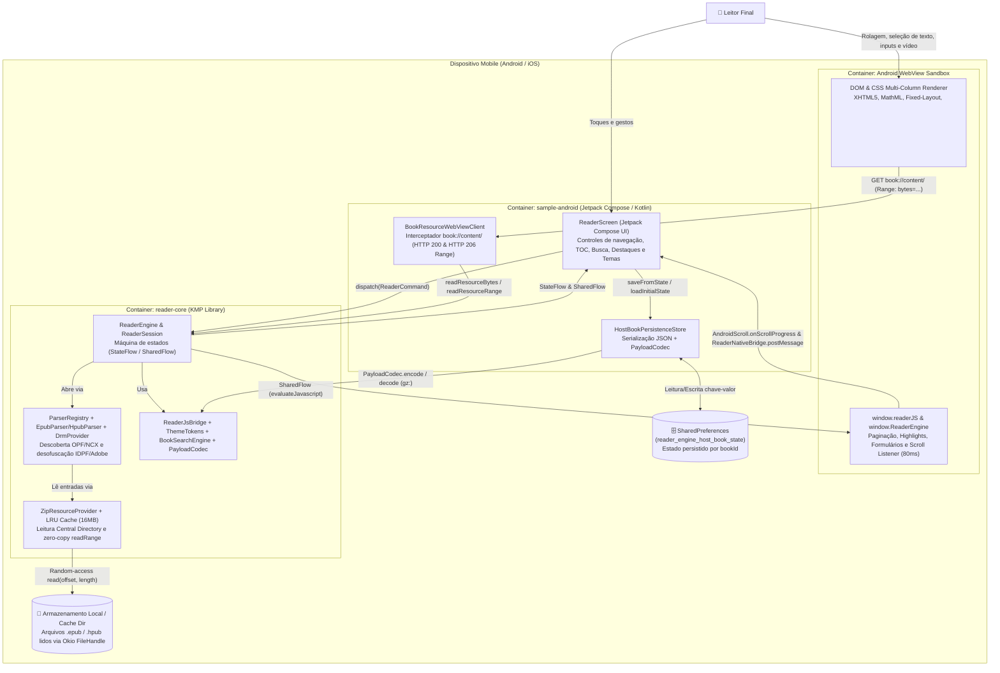

# Diagrama C4 — Nível 2: Containers (`c4-containers`)

> Gerado pelo **Architect** (Reversa v1.3.6) | Nível: `detalhado`

---

## 1. Visão de Containers

No nível de containers (unidades de execução, bibliotecas vinculadas e armazenamentos locais), o sistema divide-se entre a aplicação host (`sample-android`), a biblioteca multiplataforma (`reader-core`), o sandbox de renderização (`WebView`), o armazenamento de preferências (`SharedPreferences`) e o armazenamento em disco (`Okio FileHandle` + `LRU Cache`).

---

## 2. Inventário de Containers

| Container | Tecnologia | Responsabilidade | Comunicação | Confiança |
|-----------|------------|------------------|-------------|-----------|
| **`sample-android` (Host UI & Bridges)** | Kotlin, Jetpack Compose, Material 3, Android SDK 35 | Renderiza a interface nativa do leitor, gerencia seleção de arquivos SAF, hospeda a `WebView` e conecta eventos da sessão à persistência. | Chamadas em memória para `reader-core` e `@JavascriptInterface` com a `WebView`. | 🟢 CONFIRMADO |
| **`reader-core` (KMP Engine)** | Kotlin Multiplatform 2.4.20, Coroutines 1.9.0, Serialization 1.7.3, Okio 3.9.1 | Executa parsing de EPUB/HPUB/JSON, desofuscação de fontes, busca textual, máquina de estado `ReaderSession` e injeção de HTML/CSS/JS. | API Kotlin pública (`explicitApi()`) + `FlowSubscription` para iOS. | 🟢 CONFIRMADO |
| **`Android WebView Sandbox`** | Chromium Android WebView (`allowFileAccess = false`) | Renderiza o capítulo XHTML atual, aplica variáveis CSS de tema e colunas de paginação, reproduz mídia HTML5 e captura interações de texto/formulário. | Interceptação `shouldInterceptRequest` (`book://content/`), `evaluateJavascript` e `@JavascriptInterface`. | 🟢 CONFIRMADO |
| **`SharedPreferences` (`reader_engine_host_book_state`)** | Android `SharedPreferences` + JSON / GZIP Base64 | Armazena por `bookId` (`sha256-...`) a página atual, `scrollY`, modo de leitura, tema, tamanho de fonte, bookmarks, highlights e formulários. | Leitura síncrona na abertura e escrita assíncrona a cada evento de mutação. | 🟢 CONFIRMADO |
| **`Armazenamento Local / Okio FileHandle`** | Sistema de arquivos POSIX/Android via `okio.FileSystem.SYSTEM` | Mantém o arquivo `.epub`/`.hpub` em disco permitindo leitura aleatória (`FileHandle.read(offset, ...)`) sem carregar o arquivo completo na RAM. | I/O de blocos gerenciado por `ZipResourceProvider` com `Mutex`. | 🟢 CONFIRMADO |
