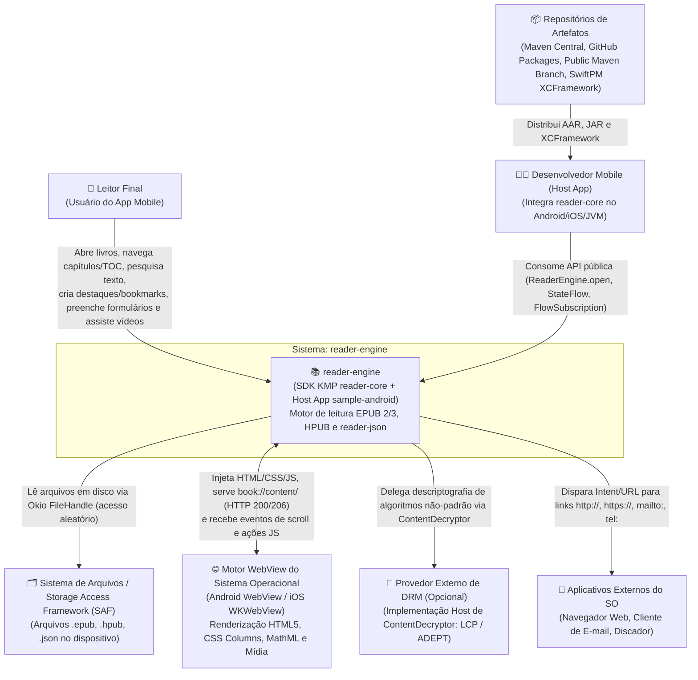

# Diagrama C4 — Nível 1: Contexto do Sistema (`c4-context`)

> Gerado pelo **Architect** (Reversa v1.3.6) | Nível: `detalhado`

---

## 1. Visão de Contexto

O diagrama abaixo posiciona o ecossistema **`reader-engine`** no centro, destacando os dois perfis de usuários (**Leitor Final** e **Desenvolvedor Consumidor do SDK**) e os sistemas externos com os quais interage em tempo de execução e publicação.

---

## 2. Descrição dos Atores e Sistemas Externos

| Elemento | Tipo | Papel e Protocolo de Interação | Confiança |
|----------|------|--------------------------------|-----------|
| **Leitor Final** | Persona / Usuário | Utiliza a interface gráfica para ler publicações, alterar temas/fontes, pesquisar termos e interagir com formulários e mídias. | 🟢 CONFIRMADO |
| **Desenvolvedor Mobile (Host App)** | Persona / Integrador | Importa `com.readerengine:reader-core` via Gradle ou SwiftPM e acopla `ReaderSession` à sua camada de UI e persistência. | 🟢 CONFIRMADO |
| **Sistema de Arquivos / SAF** | Sistema Externo (SO) | Fornece os descritores de arquivo ou caminhos locais (`okio.Path`) dos livros digitais abertos pelo usuário. | 🟢 CONFIRMADO |
| **Motor WebView do SO** | Subsistema Nativo | Renderiza o XHTML transformado pelo `ReaderJsBridge`, executa `window.readerJS` e requisita recursos `book://content/` com suporte a `Range`. | 🟢 CONFIRMADO |
| **Provedor Externo de DRM** | Plugin Host (`ContentDecryptor`) | Contrato opcional injetado em `ReaderEngine.open(..., fallbackDecryptor)` para descriptografar bytes de capítulos ou mídias sob DRM comercial. | 🟢 CONFIRMADO |
| **Aplicativos Externos do SO** | Sistema Externo (SO) | Recebem intenções de abertura quando o leitor clica em links externos (`SpecialUrlRoute.ExternalBrowser`, `MailTo`, `Tel`). | 🟢 CONFIRMADO |
| **Repositórios de Artefatos** | Infraestrutura de Distribuição | Maven Central (`central.sonatype.com`), GitHub Packages (`maven.pkg.github.com`), branch `public-maven` e GitHub Releases (`ReaderCore.xcframework.zip`). | 🟢 CONFIRMADO |
