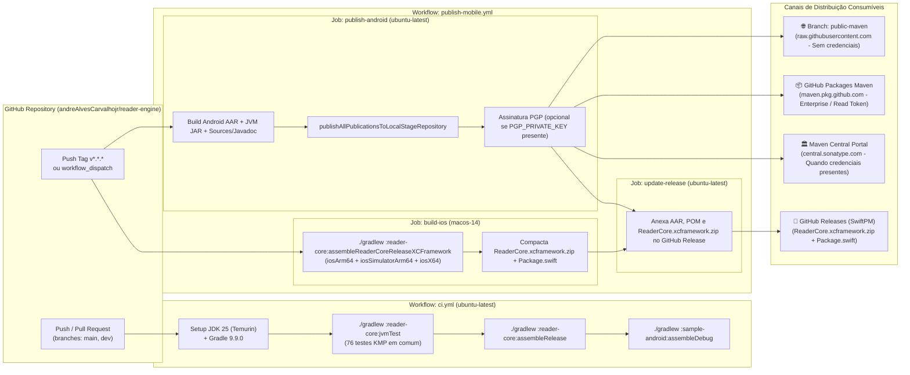

# Topologia de Build, CI/CD e Distribuição (`deployment`)

> Gerado pelo **Architect** (Reversa v1.3.6) | Nível: `detalhado`

---

## 1. Visão Geral de Infraestrutura e Entrega Contínua

Por ser uma biblioteca SDK multiplataforma (`reader-core`) acompanhada de um aplicativo Android demonstrativo (`sample-android`), o "deployment" do `reader-engine` consiste no pipeline automatizado de compilação multiplataforma (Linux + macOS), verificação de qualidade e publicação de binários assinados em **4 canais de distribuição**.

---

## 2. Ambientes e Runners de Build

| Pipeline / Arquivo | Runner OS | Toolchain | Gatilhos | Artefatos Gerados | Confiança |
|--------------------|-----------|-----------|----------|-------------------|-----------|
| [`.github/workflows/ci.yml`](file:///Users/andrealves/Documents/dev/reader-engine/.github/workflows/ci.yml) | `ubuntu-latest` | JDK 25 (`temurin`), Gradle 9.9.0, Kotlin 2.4.20, AGP 9.5.1 | `push` e `pull_request` em `main` / `dev` | Relatórios JUnit de `jvmTest`, AAR de `reader-core` e APK Debug de `sample-android`. | 🟢 CONFIRMADO |
| [`.github/workflows/publish-mobile.yml`](file:///Users/andrealves/Documents/dev/reader-engine/.github/workflows/publish-mobile.yml) (`publish-android`) | `ubuntu-latest` | JDK 25 (`temurin`), Gradle `maven-publish` + `signing` | Tag `v*` ou `workflow_dispatch` | Publicação Maven (`reader-core-android`, `reader-core-jvm`, `reader-core-kotlinMultiplatform`) em `public-maven`, GitHub Packages e Maven Central. | 🟢 CONFIRMADO |
| [`.github/workflows/publish-mobile.yml`](file:///Users/andrealves/Documents/dev/reader-engine/.github/workflows/publish-mobile.yml) (`build-ios`) | `macos-14` | Xcode + Kotlin/Native Compiler + JDK 25 | Tag `v*` ou `workflow_dispatch` | `ReaderCore.xcframework.zip` contendo slices binários para `iosArm64`, `iosSimulatorArm64` e `iosX64`. | 🟢 CONFIRMADO |

---

## 3. Variáveis de Ambiente e Segredos de Publicação

| Segredo / Propriedade | Obrigatório? | Finalidade | Comportamento de Fallback | Confiança |
|-----------------------|--------------|------------|---------------------------|-----------|
| `GITHUB_TOKEN` | Sim (Automático no GitHub Actions) | Fazer push na branch `public-maven`, publicar no GitHub Packages (`maven.pkg.github.com`) e criar GitHub Releases. | Sempre provido pelo runner do GitHub Actions (`permissions: contents: write, packages: write`). | 🟢 CONFIRMADO |
| `MAVEN_CENTRAL_USERNAME` / `MAVEN_CENTRAL_PASSWORD` | Não (Opcional) | Autenticar na API de staging da Sonatype (`ossrh-staging-api.central.sonatype.com`). | Se ausente, o step `Publish to Maven Central` é ignorado graciosamente sem falhar o workflow. | 🟢 CONFIRMADO |
| `PGP_PRIVATE_KEY` / `PGP_PASSPHRASE` | Não (Opcional) | Assinar artefatos `.aar`, `.jar` e `.pom` com GPG em memória (`useInMemoryPgpKeys`). | Se ausente, os artefatos são publicados sem assinatura `.asc` nos canais GitHub (`public-maven` e GitHub Packages). | 🟢 CONFIRMADO |
