# Diagrama Entidade-Relacionamento Completo (`erd-complete`)

> Gerado pelo **Architect** (Reversa v1.3.6) | Nível: `detalhado`

---

## 1. Modelo de Dados de Domínio e Persistência

Como o `reader-engine` opera em memória com persistência chave-valor serializada em JSON (`HostBookPersistenceStore` + `PayloadCodec`), o diagrama ER abaixo representa todas as entidades de domínio e persistência, suas chaves lógicas e cardinalidades exatas (`1:1`, `1:N`).

```mermaid
erDiagram
    SOURCE ||--|| PUBLICATION : "parses into"
    PUBLICATION ||--|| METADATA : "describes"
    PUBLICATION ||--o{ RESOURCE : "packages"
    PUBLICATION ||--o{ TOC_ENTRY : "structures hierarchy"
    TOC_ENTRY ||--o{ TOC_ENTRY : "children"
    PUBLICATION ||--|| RESOURCE_PROVIDER : "reads bytes from"
    RESOURCE_PROVIDER ||--o{ ENCRYPTED_RESOURCE_INFO : "decrypts via"

    READER_SESSION ||--|| PUBLICATION : "manages"
    READER_SESSION ||--|| READER_STATE : "exposes current"
    READER_STATE ||--|| METADATA : "includes"
    READER_STATE ||--|| READING_PROGRESS : "calculates"
    READER_STATE ||--|| THEME_TOKENS : "styles with"
    READER_STATE ||--|| LOCATOR : "tracks currentLocator"
    READER_STATE ||--o{ BOOKMARK : "contains"
    READER_STATE ||--o{ HIGHLIGHT_ITEM : "contains"
    READER_STATE ||--o{ FORM_ENTRY : "contains"
    READER_STATE ||--o{ SEARCH_RESULT : "lists current"
    SEARCH_RESULT ||--o| LOCATOR : "points to"

    INITIAL_BOOK_STATE ||--o{ BOOKMARK : "hydrates/persists"
    INITIAL_BOOK_STATE ||--o{ HIGHLIGHT_ITEM : "hydrates/persists"
    INITIAL_BOOK_STATE ||--o{ FORM_ENTRY : "hydrates/persists"
    INITIAL_BOOK_STATE ||--o| THEME_TOKENS : "hydrates/persists"

    PUBLICATION {
        string format "epub | hpub | reader-json"
        string_list pages "XHTML/HTML chapters"
        string_list pageHrefs "Normalized spine hrefs"
    }

    METADATA {
        string title "Required"
        string author "Nullable"
        string language "Nullable (e.g. pt-BR)"
        string identifier "Nullable (OPF unique-identifier)"
        string description "Nullable"
        string publisher "Nullable"
        string coverHref "Nullable"
        string renditionLayout "reflowable | pre-paginated"
        string renditionOrientation "auto | landscape | portrait"
        string renditionSpread "auto | none | both"
    }

    RESOURCE {
        string href PK "Normalized internal path"
        string mediaType "MIME type"
        byte_array bytes "Optional in-memory payload"
        string_map properties "OPF item properties"
    }

    ENCRYPTED_RESOURCE_INFO {
        string uri PK "Normalized resource href"
        string algorithm "IDPF | Adobe | Custom URI"
        long originalLength "Nullable uncompressed size"
    }

    TOC_ENTRY {
        string id PK "Node identifier"
        string title "Section title"
        int pageIndex FK "Target spine index (0..N-1)"
        string href "Target href"
        string fragment "Optional #anchor"
    }

    LOCATOR {
        string href "Chapter href"
        int pageIndex "Spine index"
        double progression "0.0..1.0 within chapter"
        double totalProgression "0.0..1.0 across book"
        string title "Optional chapter title"
        string textQuote "Optional snippet"
    }

    READER_STATE {
        string bookId PK "sha256DocumentId"
        int currentPage "0..totalPages-1"
        int totalPages ">= 1"
        string currentChapterTitle "Nullable"
        string currentPageContent "Raw chapter HTML"
        string currentPageHref "Nullable"
        int scrollY ">= 0 px"
        string readingMode "SCROLLED | PAGINATED"
        int currentSubPage ">= 0"
        int totalSubPages ">= 1"
        int fontSizeSp "12..36"
    }

    READING_PROGRESS {
        int currentPage "0..totalPages-1"
        int totalPages ">= 1"
        int scrollY ">= 0"
        int contentHeightPx ">= 0"
        int viewportHeightPx ">= 0"
        double percentage "0.0..100.0 monotonic"
    }

    BOOKMARK {
        int pageIndex PK "Unique per page in book"
        int scrollY "Vertical offset px"
        string label "Optional user note"
        long createdAtEpochMs "Timestamp"
    }

    HIGHLIGHT_ITEM {
        string id PK "Unique highlight ID"
        int pageIndex FK "Spine page index"
        string text "Selected non-blank text"
        string style "YELLOW | GREEN | BLUE | PINK | UNDERLINE"
        string note "Optional annotation"
        string prefix "Optional context before"
        string suffix "Optional context after"
        long createdAtEpochMs "Timestamp"
    }

    FORM_ENTRY {
        int pageIndex PK "Composite PK part 1"
        string key PK "Composite PK part 2 (field name/id)"
        string value "Field value"
        long updatedAtEpochMs "Timestamp"
    }

    SEARCH_RESULT {
        int pageIndex FK "Spine page index"
        string snippet "Context window (-45..+55 chars)"
        int matchOffset "0-based char offset in plain text"
        int matchLength "Length of matched query"
    }

    THEME_TOKENS {
        string designLanguage "MATERIAL3 | HIG | FLUENT | CUSTOM"
        boolean isNight "Dark mode flag"
        string surfaceColorHex "CSS sanitized color"
        string onSurfaceColorHex "CSS sanitized color"
        string accentColorHex "CSS sanitized color"
        string highlightColorHex "CSS sanitized color"
        string linkColorHex "CSS sanitized color"
        string codeBackgroundHex "CSS sanitized color"
        string borderColorHex "CSS sanitized color"
        int cornerRadiusPx ">= 0"
        double fontScale "Typography multiplier"
        string bodyFontFamily "CSS sanitized font-family"
    }

    INITIAL_BOOK_STATE {
        string bookId PK "Key in SharedPreferences"
        int currentPage "Restored page"
        int scrollY "Restored scroll offset"
        string readingMode "Restored mode"
        int fontSizeSp "Restored font size"
    }
```

---

## 2. Regras de Integridade e Chaves de Identidade

| Entidade | Chave de Identidade / Unicidade | Regra de Substituição (Upsert) | Confiança |
|----------|---------------------------------|--------------------------------|-----------|
| `ReaderState` / `InitialBookState` | `bookId` (`Source.sha256DocumentId()`) | Cada livro possui uma única entrada `book_<bookId>` em `SharedPreferences`. | 🟢 CONFIRMADO |
| `Bookmark` | `pageIndex` | Adicionar um bookmark em uma página que já possui bookmark substitui o registro anterior daquela página (`bookmarks.filterNot { it.pageIndex == page } + newBookmark`). | 🟢 CONFIRMADO (`ReaderSession.kt:263`) |
| `HighlightItem` | `id` (ou `(pageIndex, text)` se `id` coincidir) | `bookmarks`/`highlights` filtram por `id` ao atualizar ou remover (`highlights.filterNot { it.id == resolvedId }`). | 🟢 CONFIRMADO (`ReaderSession.kt:287`) |
| `FormEntry` | Chave composta `(pageIndex, key)` | `SetFormValue` remove qualquer entrada existente com o mesmo `(currentPage, normalizedKey)` antes de inserir o novo valor. | 🟢 CONFIRMADO (`ReaderSession.kt:318`) |
