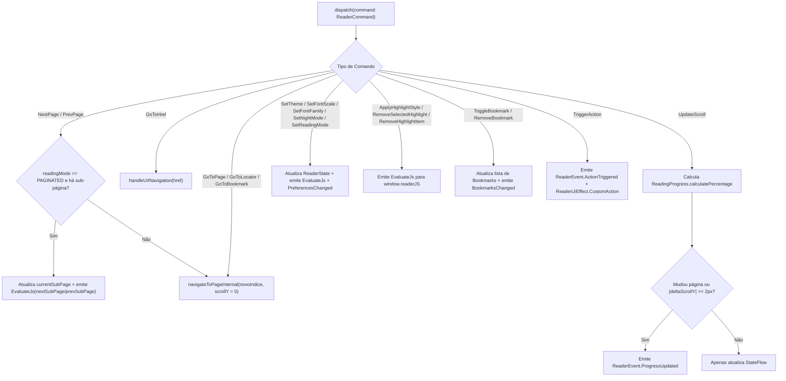

# Fluxograma por Função — `ReaderSession.dispatch(command)`

> **Gerado por:** Reversa Archaeologist (`escavacao` — Nível `detalhado`)
> **Localização:** `reader-core/src/commonMain/kotlin/com/readerengine/core/session/ReaderSession.kt:364-563`

