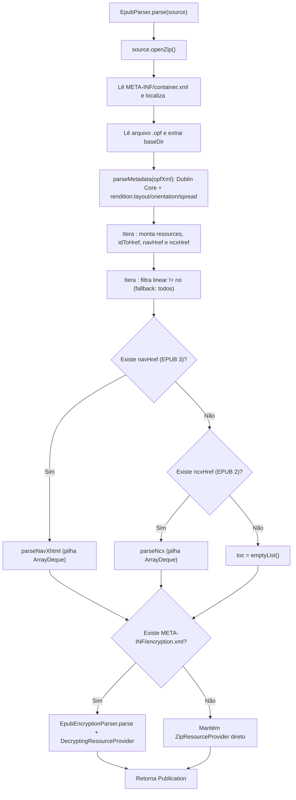

# Fluxograma por Função — `EpubParser.parse(source)`

> **Gerado por:** Reversa Archaeologist (`escavacao` — Nível `detalhado`)
> **Localização:** `reader-core/src/commonMain/kotlin/com/readerengine/core/parser/EpubParser.kt:30-115`

