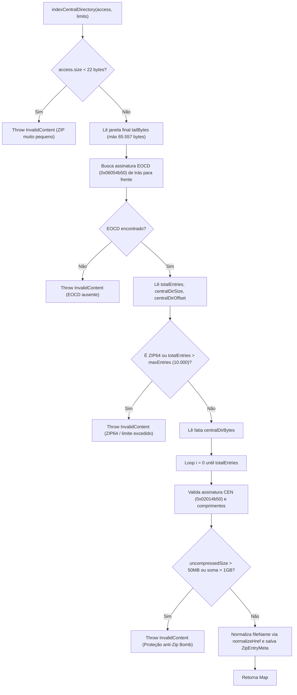

# Fluxograma por Função — `ZipResourceProvider.indexCentralDirectory` & `read`

> **Gerado por:** Reversa Archaeologist (`escavacao` — Nível `detalhado`)
> **Localização:** `reader-core/src/commonMain/kotlin/com/readerengine/core/provider/ResourceProviders.kt:308-483`

