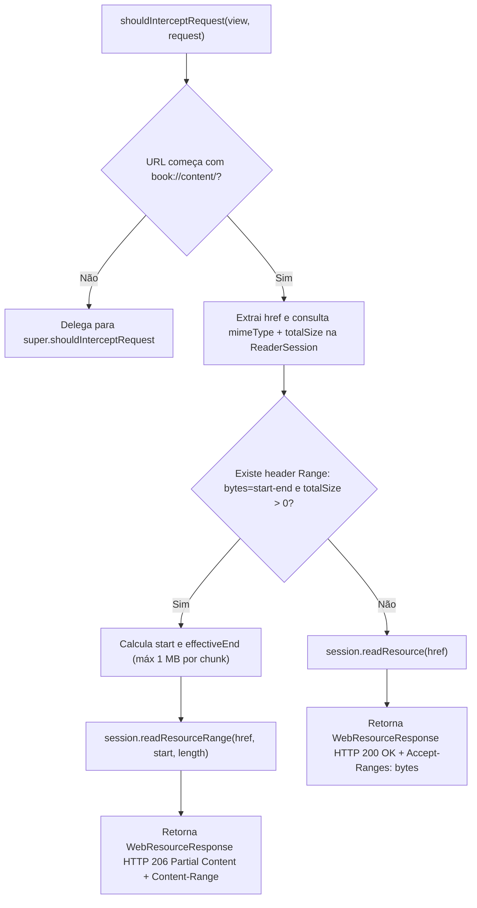

# Fluxograma por Função — `BookResourceWebViewClient.shouldInterceptRequest` (HTTP 206)

> **Gerado por:** Reversa Archaeologist (`escavacao` — Nível `detalhado`)
> **Localização:** `sample-android/src/main/java/com/readerengine/app/MainActivity.kt:354-421`

