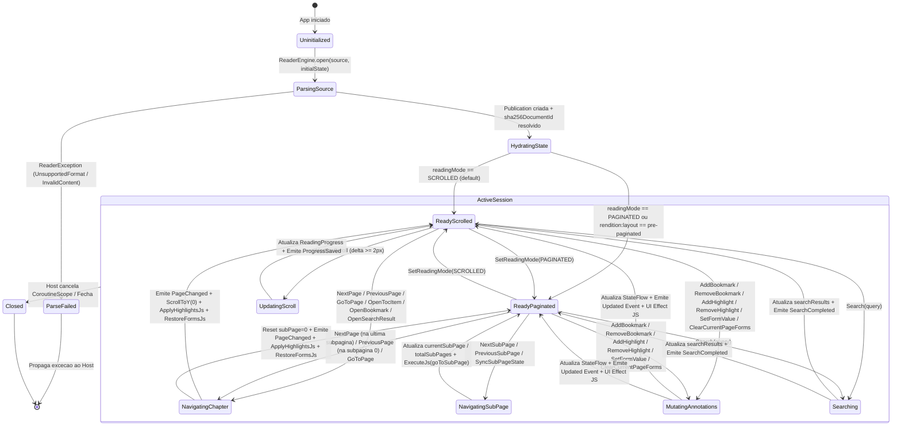
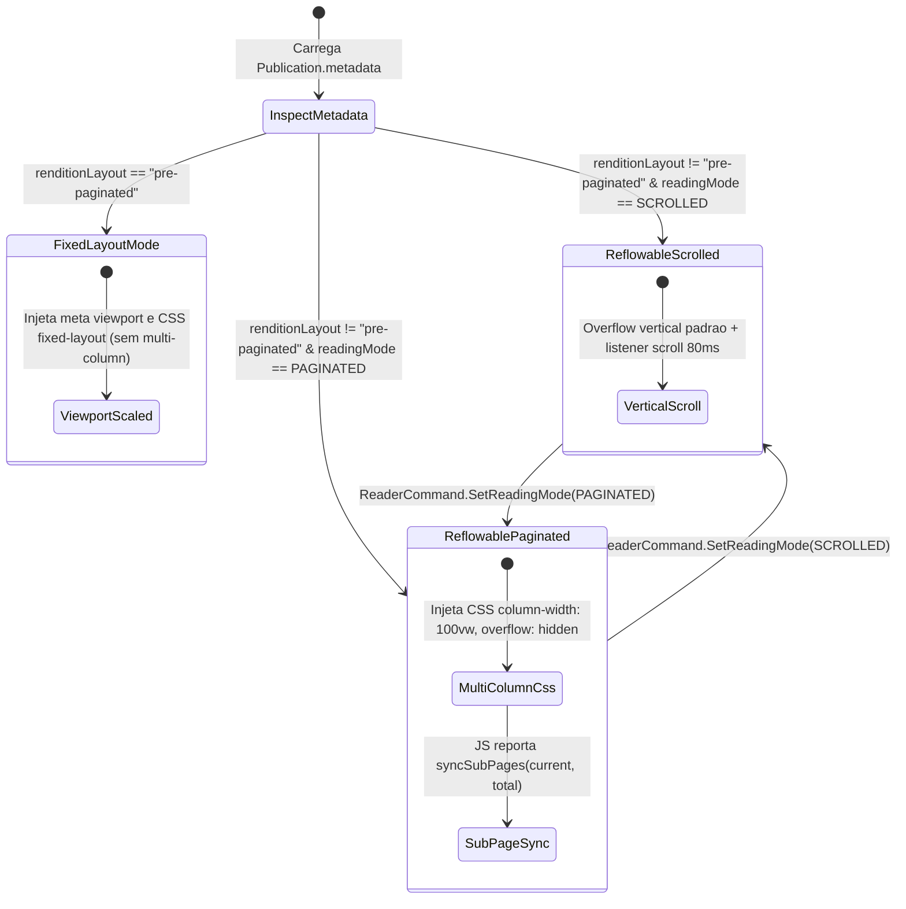
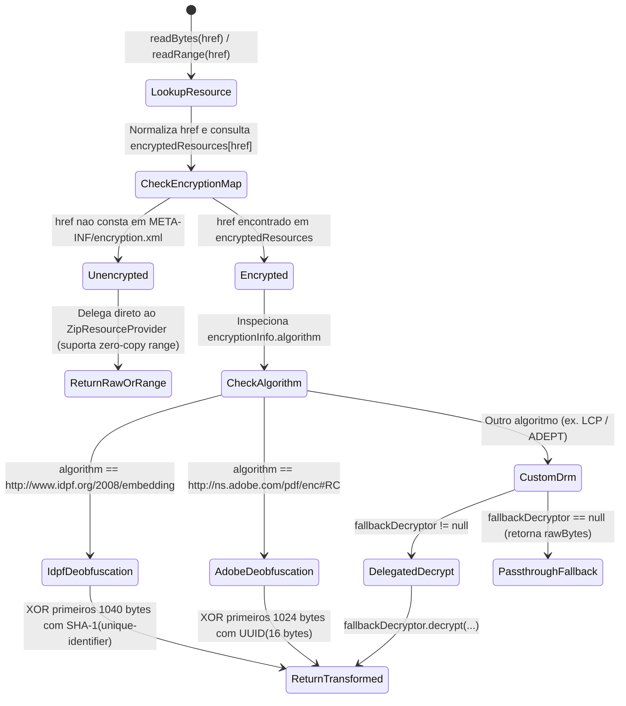

# Máquinas de Estado — `reader-engine`

> Gerado pelo **Detective** (Reversa v1.3.6) | Nível: `detalhado`

---

## 1. Máquina de Estados da Sessão de Leitura (`ReaderSession`)

Embora `ReaderState` seja uma `data class` imutável exposta via `StateFlow<ReaderState>`, o ciclo de vida completo de uma sessão de leitura desde a abertura do `Source` até o fechamento/troca de livro segue estados bem definidos governados por `ReaderEngine.open(...)` e `ReaderSession.dispatch(ReaderCommand)`.

### 1.1 Diagrama de Estados do Ciclo de Vida da Sessão

### 1.2 Tabela de Transições de `ReaderSession.dispatch(ReaderCommand)`

| Estado Origem | Comando (`ReaderCommand`) | Condição de Guarda | Estado Destino / Mutação em `ReaderState` | Eventos Emitidos (`ReaderEvent`) | Efeitos de UI (`ReaderUiEffect`) | Confiança |
|---------------|---------------------------|--------------------|-------------------------------------------|----------------------------------|----------------------------------|-----------|
| `Ready*` | `NextPage` | `currentPage < totalPages - 1` | `currentPage + 1`, `scrollY = 0`, `currentSubPage = 0` | `PageChanged`, `ProgressSaved` | `ScrollToY(0)`, `ApplyHighlightsJs`, `RestoreFormsJs` | 🟢 CONFIRMADO |
| `Ready*` | `NextPage` | `currentPage >= totalPages - 1` | Sem mutação de página | `Error(PAGE_OUT_OF_RANGE)` | `ShowNotice(alreadyAtLastPage)` | 🟢 CONFIRMADO |
| `Ready*` | `PreviousPage` | `currentPage > 0` | `currentPage - 1`, `scrollY = 0`, `currentSubPage = 0` | `PageChanged`, `ProgressSaved` | `ScrollToY(0)`, `ApplyHighlightsJs`, `RestoreFormsJs` | 🟢 CONFIRMADO |
| `Ready*` | `PreviousPage` | `currentPage == 0` | Sem mutação de página | `Error(PAGE_OUT_OF_RANGE)` | `ShowNotice(alreadyAtFirstPage)` | 🟢 CONFIRMADO |
| `Ready*` | `GoToPage(page)` | `page in 0 until totalPages` | `currentPage = page`, `scrollY = 0`, `currentSubPage = 0` | `PageChanged`, `ProgressSaved` | `ScrollToY(0)`, `ApplyHighlightsJs`, `RestoreFormsJs` | 🟢 CONFIRMADO |
| `Ready*` | `GoToPage(page)` | `page !in 0 until totalPages` | Sem mutação | `Error(INVALID_PAGE_TARGET)` | `ShowNotice(invalidTargetPage)` | 🟢 CONFIRMADO |
| `ReadyScrolled` | `UpdateScroll(y, ch, vh)` | `abs(y - scrollY) >= 2` ou dimensões mudaram | Atualiza `scrollY` e `progress` (`ReadingProgress`) | `ProgressSaved(progress)` | Nenhum | 🟢 CONFIRMADO |
| `ReadyPaginated` | `NextSubPage` | `currentSubPage < totalSubPages - 1` | `currentSubPage + 1` | `ProgressSaved` | `ExecuteJs("window.readerJS.nextSubPage()")` | 🟢 CONFIRMADO |
| `ReadyPaginated` | `NextSubPage` | `currentSubPage >= totalSubPages - 1` | Delega internamente para `NextPage` | `PageChanged`, `ProgressSaved` | Transição para próximo capítulo | 🟢 CONFIRMADO |
| `ReadyPaginated` | `PreviousSubPage` | `currentSubPage > 0` | `currentSubPage - 1` | `ProgressSaved` | `ExecuteJs("window.readerJS.prevSubPage()")` | 🟢 CONFIRMADO |
| `ReadyPaginated` | `PreviousSubPage` | `currentSubPage == 0` | Delega internamente para `PreviousPage` | `PageChanged`, `ProgressSaved` | Transição para capítulo anterior | 🟢 CONFIRMADO |
| `Ready*` | `SetReadingMode(mode)` | `mode != readingMode` | Atualiza `readingMode`, reseta `currentSubPage = 0` | `ReadingModeUpdated(mode)` | Re-renderização HTML da página no host | 🟢 CONFIRMADO |
| `Ready*` | `AddBookmark(label)` | Sempre permitido | Adiciona/atualiza `Bookmark` para `currentPage` e `scrollY` | `BookmarksUpdated` | `ShowNotice(bookmarkAdded)` | 🟢 CONFIRMADO |
| `Ready*` | `RemoveBookmark(page)` | Sempre permitido | Remove `Bookmark` com `pageIndex == page` | `BookmarksUpdated` | `ShowNotice(bookmarkRemoved)` | 🟢 CONFIRMADO |
| `Ready*` | `AddHighlight(...)` | `text.isNotBlank()` | Insere/atualiza `HighlightItem` | `HighlightsUpdated` | `ApplyHighlightsJs`, `ShowNotice(highlightSaved)` | 🟢 CONFIRMADO |
| `Ready*` | `AddHighlight(...)` | `text.isBlank()` | Sem mutação | `Error(EMPTY_HIGHLIGHT_TEXT)` | `ShowNotice(emptyHighlightText)` | 🟢 CONFIRMADO |
| `Ready*` | `SetFormValue(key, val)` | `key.isNotBlank()` | Insere/atualiza `FormEntry(currentPage, key, val)` | `FormsUpdated` | Nenhum | 🟢 CONFIRMADO |
| `Ready*` | `ClearCurrentPageForms` | Sempre permitido | Remove todos os `FormEntry` de `currentPage` | `FormsUpdated` | `TriggerClearFormsJs`, `ShowNotice(formsCleared)` | 🟢 CONFIRMADO |
| `Ready*` | `SetTheme(tokens)` | Sempre permitido | Atualiza `theme = tokens` | `ThemeUpdated` | `ApplyThemeJs` | 🟢 CONFIRMADO |
| `Ready*` | `SetFontSize(sp)` | Coerced para `12..36` | Atualiza `fontSizeSp` | `FontSizeUpdated` | `ApplyFontSizeJs` | 🟢 CONFIRMADO |

---

## 2. Máquina de Estados de Modo de Renderização (`ReadingMode` & `RenditionLayout`)

O motor combina a preferência do usuário (`ReadingMode`: `SCROLLED` vs `PAGINATED`) com os metadados estruturais do EPUB 3 (`Metadata.renditionLayout`: `"reflowable"` vs `"pre-paginated"`).

---

## 3. Máquina de Estados do Ciclo de Desofuscação / Descriptografia (`DecryptingResourceProvider`)

Para cada leitura de recurso (`readBytes` ou `readRange`) em um arquivo EPUB:

